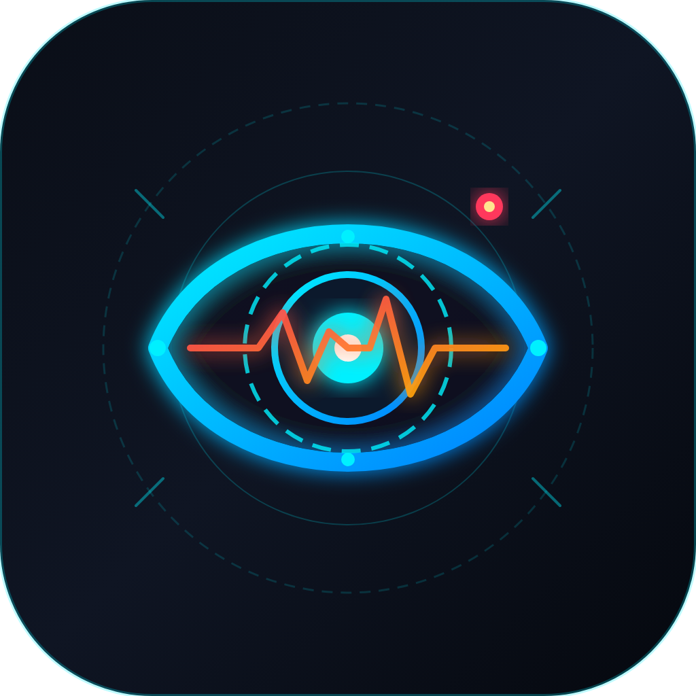

<p align="center">
  
</p>

<h1 align="center">FatigueVision AI</h1>

<p align="center">
  <strong>Real-time driver fatigue monitoring system using computer vision and machine learning.</strong>
</p>

<p align="center">
  
  
  
  
  
  
  
</p>

<p align="center">
  
  
</p>

---

## Caracteristicas Principales

- **Deteccion en tiempo real** — EAR (Eye Aspect Ratio), MAR (Mouth Aspect Ratio), PERCLOS y blink rate calculados sobre ventanas deslizantes de 5 segundos.
- **Modelo ML optimizado** — `fatigue_v3.joblib` (RandomForest, CV F1-macro 0.8857) con override en tiempo real para cierres de ojos instantaneos.
- **Dashboard ebony-clay** — Panel de control con paleta oscura, gauge de riesgo, metricas en vivo y overlay facial con 468 landmarks.
- **Alarmas criticas** — 4 tipos de alarma sonora (beep, siren, emergency, buzzer) con Web Audio API, volumen fijo al 100%.
- **Procesamiento local** — Todo el pipeline corre en la maquina, sin dependencia de servicios externos.

## Arquitectura del Monorepo

```
FatigueVisionAI/
├── apps/
│   ├── web/              # Frontend React + Vite + Tailwind CSS
│   └── backend/          # API FastAPI + WebSocket
├── packages/
│   ├── ai-engine/        # Modelo ML y pipeline de inferencia
│   ├── feature-extractor/# Geometria facial y ventanas deslizantes
│   ├── vision-engine/    # Deteccion facial con MediaPipe
│   └── contracts/        # Esquemas compartidos TS/Python
├── datasets/             # Datos de entrenamiento (YAWDD, etc.)
└── models/               # Modelos de IA (no commiteados)
```

## Instrucciones de Ejecucion Local

### Inicio Rapido (Recomendado)

Los scripts automatizan la instalacion de dependencias, el levantamiento del backend y frontend, y abren el navegador automaticamente.

**Windows:**
```bat
start_app.bat
```

**Linux / macOS:**
```bash
bash start_app.sh
```

> Los scripts detectan si las dependencias ya estan instaladas y las omiten en futuras ejecuciones.

### Inicio Manual

#### Requisitos

- **Node.js** 22+ y **pnpm** (via corepack)
- **Python** 3.12+ y **uv**

#### Frontend

```bash
cd apps/web
npm install
npm run dev          # http://localhost:5173
```

#### Backend

```bash
cd apps/backend
python -m venv .venv
. .venv/bin/activate  # Linux/macOS
# .venv\Scripts\activate  # Windows

uv pip install -e ../../packages/feature-extractor
uv pip install -e ../../packages/ai-engine
uv pip install -e ../../packages/vision-engine
uv pip install -e .

CAMERA_SOURCE=browser FATIGUE_MODEL_TYPE=ml uvicorn app.main:app --host 127.0.0.1 --port 8000
```

El backend expone `http://localhost:8000/api/vision/status` y el WebSocket en `ws://localhost:8000/ws`.

### Comandos Disponibles

| Comando | Accion |
|---------|--------|
| `start_app.bat` / `bash start_app.sh` | Inicio automatico completo |
| `npm run dev` | Dev server frontend (puerto 5173) |
| `npm run build` | Build de produccion |
| `uvicorn app.main:app --reload` | Backend con hot-reload (puerto 8000) |

## Estado del Proyecto

| Sprint | Estado | Descripcion |
|--------|--------|-------------|
| **S1** | Completado | Vision Engine, Feature Extractor, AI Engine (heuristica), Backend WS, Frontend dashboard |
| **S2** | Completado | Infraestructura de datasets, modelo ML entrenado (v3, F1-macro 0.8857) |
| **S3** | Completado | Umbral critico ajustado, override en tiempo real, head-pose guard |
| **S4** | Completado | UX ebony-clay, logo, settings panel, alarmas, scripts de distribucion local |

**Proyecto completado.** Sistema funcional end-to-end: camara del navegador → WebSocket → MediaPipe face detection → ML fatigue assessment → dashboard en tiempo real.

---

<p align="center">
  <sub>Construido con pasion para la seguridad vial.</sub>
</p>
